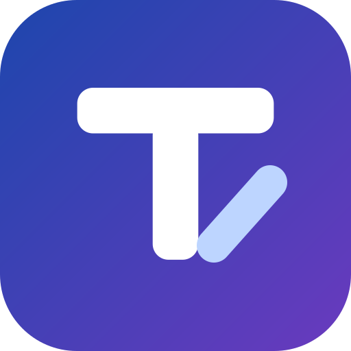

  

  <h1>TeachApp</h1>

  
<strong>От школьного урока до финального свистка.</strong>

  
Единое рабочее пространство учителя физической культуры и волейбольного тренера

  
  

   

  
  
  
  
  

  
Компьютер · iPhone · Android · Планшет

---

## О проекте

> Версия этой ветки **5.3.0-rc.1** (разработка). Статус публикации — в main и GitHub Actions. Новый Delta-протокол остаётся экспериментальным, обычный профиль не переключается. [Приёмка выпуска](docs/RELEASE-5.2-ACCEPTANCE.md). Физическая приёмка на устройствах выполняется отдельно. Не очищайте хранилище сайта и обновите все синхронизируемые устройства перед обменом новыми типами записей.

**TeachApp** — специализированное веб-приложение для ежедневной работы учителя физкультуры и тренера по волейболу. Оно объединяет электронный журнал, календарно-тематическое планирование (КТП), нормативы, учёт ограничений физической нагрузки, управление командой, проведение матчей и аналитику.

Приложение устанавливается как PWA, работает без постоянного доступа к интернету и сохраняет записи непосредственно на устройстве. Для обмена между доверенными устройствами предусмотрена отдельная опциональная синхронизация, а для зрителей — публичный портал с результатами и счётом матча.

| 🎓 Учитель | 🏐 Тренер |
| :--- | :--- |
| Уроки, классы, журнал и КТП | Команды, составы и тренировки |
| Посещаемость, оценки и нормативы | Расстановки, замены и live-матчи |
| Медицинские ограничения и участие | Индивидуальная и командная статистика |
| Аналитика, планы, документы | Тактика, видеоразбор и план сезона |

[Начать работу](#быстрый-старт) · [Все функции учителя](#учитель-физической-культуры) · [Все функции тренера](#тренер-по-волейболу) · [Синхронизация](#синхронизация-устройств) · [Разработка](#разработка)

## Учитель физической культуры

### Рабочий день и классы

| Раздел | Возможности |
| :--- | :--- |
| Главная | Уроки на сегодня, темы КТП, прогресс рабочего дня, быстрый переход к незавершённому занятию. |
| Центр управления | Незавершённые уроки, неполная явка, пропущенные записи, истекающие ограничения, сроки задач и напоминание о резервной копии. |
| Классы | Карточки классов, поиск, количество учеников, показатели посещаемости, удобные обозначения (7-1, 7А). |
| Сегодня в классах | Компактный список занятий с темой, статусом проверки нагрузки и количеством учеников с найденными ограничениями; переход к подробностям. |
| Состав класса | Добавление и редактирование учеников, параллель, категория нормативов, медицинские группы и индивидуальные ограничения. |
| Профиль ученика | Оценки, динамика успеваемости, посещаемость, итоговые отметки, история нормативов, участия и физической подготовки. |

### Подготовка уроков и закрытие периода

- Подготовка конкретного слота: тема, конспект, назначенные нормативы, точные и возможные совпадения ограничений на дату урока.
- Центр закрытия периода по всем классам: отсутствующие записи, неподтверждённые уроки, неизвестная явка, оценки, итоги и задания к сроку. Сводка не заполняет журнал автоматически.
- Резервный сценарий — отдельный редактируемый конспект. Конструктор круговой тренировки рассчитывает длительность, вместимость и параллельную потребность в исправном инвентаре; не назначает детей по станциям автоматически.

### Электронный журнал

- Таблица уроков с закреплёнными номерами и именами учеников, датами, днями недели и темами КТП.
- Фамилия и имя в журнале; полное ФИО сохраняется в данных ученика.
- Оценки 1–5, отсутствие, освобождение, вес оценки и фактическое участие.
- Быстрый ввод с клавиатуры и через экран проведения урока.
- Поиск ученика, горизонтальная навигация по датам, быстрый переход к итоговым колонкам.
- Средний балл и фактическая посещаемость: неотмеченные и будущие занятия не считаются автоматически посещёнными.
- История изменения оценок и веса, отмена последней правки с проверкой актуальности записи.
- Отдельные итоговые оценки за завершённые периоды с ручным подтверждением. Архив прежних месячных отметок сохраняется.

### Расписание, учебный год и КТП

В разрабатываемой ветке 5.3: отдельная история КТП, контрольные версии, автоматическое сохранение перед заменой или удалением, сравнение тем и восстановление отдельной копией. Использованные в уроках темы не удаляются. Полная резервная копия включает историю; выборочная копия класса её не включает.

| Инструмент | Что можно делать |
| :--- | :--- |
| Учебные периоды | Настраивать триместры, четверти, полугодия и собственные интервалы. Текущий период выбирается по локальной дате; другие доступны вручную. |
| Каникулы | Задать общие даты один раз для всех классов. Планировщик и дневное расписание исключают эти даты, ранее созданные уроки сохраняются. |
| Расписание | Составить недельный шаблон, импортировать его из Excel, добавлять, отменять или переносить занятия на конкретную дату. |
| КТП | Создавать тематические планы, связывать их с несколькими классами, менять порядок тем, отслеживать учебные часы и выполнение. |
| Планировщик уроков | Создавать уроки по расписанию с учётом каникул и изменений, распределять темы КТП. |
| Редактор уроков | Добавлять пропущенные даты, изменять темы и даты, удалять уроки с предупреждением о связанных записях. |
| Коррекция КТП | Просматривать предлагаемые изменения последовательности тем до применения; заполненные уроки защищены от автоматической правки. Для неоднозначных планов предусмотрено ручное редактирование. |
| Диагностика КТП | Проверять связи и точечно исправлять названия и привязки планов к классам без удаления оценок и тем. |

### Проведение урока

**Подготовка → явка → нагрузка → оценки и нормативы → подтверждение проведения**

В едином рабочем экране можно просмотреть тему и конспект, отметить присутствующих, проверить индивидуальные ограничения, выставить оценки выбранным ученикам, внести результаты нормативов и зафиксировать участие. Массовые действия защищают уже заполненные записи и требуют подтверждения. Завершение урока не заполняет неизвестную явку автоматически.

Генератор команд помогает распределить выбранных участников случайно или с учётом заданных вручную уровней, закрепить игроков и обменять их между командами. Школьные оценки не используются как автоматическая оценка спортивных способностей.

### Здоровье, освобождения и нагрузка

- Основная, подготовительная, специальные и пользовательские медицинские группы.
- Индивидуальные ограничения конкретных упражнений и категорий: бег, прыжки, силовые нагрузки, нормативы и другие.
- Периоды действия и сроки проверки, организационные указания без хранения диагнозов.
- Категории нагрузки в теме КТП и индивидуальная настройка отдельного урока.
- Предложения категорий по названию темы: учитель проверяет и подтверждает их перед сохранением.
- Проверка совпадений до занятия, выполнения норматива и выставления оценки.
- Обычное, адаптированное участие или невыполнение упражнения; основания, включая записку от родителей и документальное ограничение.
- Полное освобождение по документу, автоматическое отражение действующего ОСВ в журнале и восстановление ручной отметки после снятия последнего основания.
- История участия, отчёт CSV, контроль истекающих сведений.

> [!IMPORTANT]
> TeachApp не определяет медицинскую группу и не выдаёт медицинский допуск. Отсутствие совпадений по внесённым ограничениям не означает, что нагрузка разрешена. Если виды нагрузки неизвестны, интерфейс показывает необходимость проверки.

### Нормативы и физическая подготовка

| Возможность | Описание |
| :--- | :--- |
| Каталог | Пользовательские нормативы, единицы измерения, направление улучшения результата. |
| Шкалы | Пороги оценок 1–5 отдельно для класса, параллели и категории ученика. Более конкретная шкала имеет приоритет. |
| Импорт | Шаблоны Excel, массовый импорт шкал с предварительным просмотром и проверкой ошибок. |
| Ввод результатов | Индивидуально или по всему классу на существующем уроке; сохранение численного результата и исторического снимка шкалы. |
| Проверка ограничений | Фиксация невыполнения по основанию без автоматической плохой оценки; при отсутствии подходящей шкалы сохраняется результат без оценки. |
| Перенос в журнал | Отдельное подтверждение записи оценки, без автоматической перезаписи заполненной клетки. |
| Назначения | Явные задания по нормативам для класса и периода, сроки, целевой критерий, список выполнения и статусы проверки. |
| Паспорт подготовки | Динамика сопоставимых результатов, рекорды и история физической подготовки ученика после перевода класса. |
| Критерии техники | Редактируемые шаблоны оценки техники выполнения упражнений с ручным подтверждением результата. |

### Школьная аналитика и завершение года

- Средний балл, динамика оценок по месяцам и посещаемость по классу или ученику.
- Выполнение КТП, проведённые занятия, фактическое участие, нормативы и ограничения.
- Предложения итоговых оценок с указанием объёма исходных данных.
- Отчёты по назначенным нормативам, списки выполнения и агрегированные показатели.
- Архив завершённых учебных лет, предварительный просмотр перевода классов, сохранение исторических оценок и результатов.
- Перенос общих шкал и действующих ограничений при создании нового учебного года; новое расписание и КТП настраиваются отдельно.

## Тренер по волейболу

### Кабинет тренера

| Раздел | Возможности |
| :--- | :--- |
| Главная команды | Прогресс сезона, статистика побед, ближайшая тренировка или матч, незавершённые задачи. |
| Команды и состав | Несколько команд, номера, амплуа, профили спортсменок, архив состава без потери истории. |
| Тренировки | Календарь, цели, конспекты, упражнения, посещаемость, фактическая длительность и субъективная сложность 1–10. |
| План сезона | Этапы подготовки, сроки, цели, плановый объём тренировок и минут, сравнение с фактом по неделям. |
| Индивидуальные цели | Исходные и целевые показатели, сроки, наблюдения, задачи, упражнения и ручное подтверждение достижения. |
| Тестирование | Подача, приём, атака, передача, прыжок, высота съёма, ОФП и пользовательские методики; индивидуальный и массовый ввод. |
| Ограничения | Отдельные тренерские сведения о допустимой нагрузке; школьные медицинские записи автоматически не копируются. |
| Состав на матч | Помощник стартовой шестёрки, ручной подбор, схемы 5–1 и 4–2, сохранённые расстановки и история сочетаний. |

### Предматчевое досье и разбор

- Сравнение подачи и приёма по относительным циклам P1–P6, связки только из полностью записанных розыгрышей, окна до и после замен без причинных выводов.
- Приватная история встреч, записанные зоны, текущий состав, нагрузка за 14 дней, цели и ограничения. Черновик тренировки формируется из явно выбранных упражнений; личные цели и сведения о здоровье не переносятся в публичный экспорт.

### Live-матч и интерактивная площадка

| Перед матчем | Во время матча | После матча |
| :--- | :--- | :--- |
| Соперник, эмблемы, составы | Очки, партии, переходы | Итоговый результат |
| Расстановка по зонам 1–6 | Подача, замены, либеро, тайм-ауты | Печатный протокол |
| Выбор схемы и правил счёта | Причина очка, игрок, зона | Индивидуальная статистика |
| Стартовые шестёрки | Журнал розыгрышей, отмена действий | Тактический и видеоразбор |

Подробный режим матча включает:

- Независимые расстановки и переходы обеих команд, быстрое заполнение зон и замену позиций.
- Либеро для своей команды, тайм-ауты, замены, сохранение стартовых составов партий.
- Настраиваемый счёт партий до 15/21/25 и победа с преимуществом в два очка, формат до двух или трёх выигранных партий.
- Начисление очка с последующим уточнением причины и автора без повторного начисления.
- Фиксацию атак, скидок, эйсов, блоков, ошибок и дополнительных наблюдений приёма и защиты.
- График счёта, серии подач и динамику последних розыгрышей.
- Исправление детализации записанных розыгрышей без изменения порядка событий и счёта.
- Автосохранение черновика локально и возобновление матча после перезапуска.
- Контрастное табло, цвета и эмблемы команд, локальное зрительское окно и компактный режим для OBS.

Протокол TeachApp предназначен для работы тренера; не все официальные ограничения замен, либеро и судейского регламента моделируются.

### История матчей, статистика и разбор

- Ручной ввод результата, архив матчей, поиск по сопернику и турниру, фильтры периода, результата и источника.
- Сравнение матчей по партиям, очкам и доступным тактическим показателям.
- Протоколы с составами, счётом партий, длительностью, заменами, расстановками, журналом очков и полями подписей.
- Импорт поддерживаемых текстовых PDF VolleyPoint: предпросмотр, сопоставление игроков, результаты партий, статистика и защита от дублей. Сканированные и неподдерживаемые PDF не распознаются.
- Сезонная аналитика команды: рейтинги, сравнение спортсменок, индивидуальные графики, динамика сопоставимых тестов и тренерские подсказки.
- Тактическая разведка: карты атак, скидок, эйсов и ошибок, зоны площадки, фильтры по командам, партиям и игрокам.
- Циклы переходов, розыгрыши на подаче и приёме, фактические шестёрки, сочетания игроков, концовки и окна до/после тайм-аутов.
- Послематчевые выводы, план работы и отчёт с указанием объёма наблюдений.
- Локальный видеоразбор: ручное совмещение первого очка и переход к приблизительным моментам розыгрышей, без загрузки видео на сервер.
- Тактическая доска: фишки, перемещения, стрелки мяча, отмена и сохранение схем.

Неизвестные действия, попытки или игровое время не реконструируются. Статистика отражает зафиксированные наблюдения, а не гарантированно полную картину матча.

## Зрительский портал

  <a href="https://forz1k.github.io/teachapp/live/"><strong>Открыть LIVE — зрительская страница команды →</strong></a>

Отдельная публичная страница позволяет следить за матчем без установки TeachApp и входа в кабинет тренера.

| Для зрителей | Для тренера |
| :--- | :--- |
| Расписание предстоящих встреч и обратный отсчёт | Подготовка встречи и публикация после подтверждения |
| Текущий счёт, партии, подача и лента событий | Обновление счёта по мере записи действий |
| Последний результат, архив, фильтры побед и поражений | Публикация сохранённых и импортированных результатов |
| Эмблемы, трофеи, серии побед, светлая и тёмная темы | Редактирование и снятие результатов с публикации |
| Предупреждение о потере связи и устаревших данных | Постоянная ссылка команды и управление авторизацией |

Публичный портал использует Firebase Realtime Database и авторизацию тренера. Локальный матч продолжает работать при пропадании интернета. На сервер передаётся только разрешённая публичная проекция; имена, медицинские данные, контакты и закрытая тактика не публикуются. Номера игроков по умолчанию скрыты.

[Настройка Firebase и правила доступа](docs/public-portal-firebase.md)

## Общие рабочие инструменты

| Инструмент | Возможности |
| :--- | :--- |
| Рабочий календарь | Уроки, тренировки, матчи, соревнования, задачи, события, каникулы и сроки ограничений; дневной и месячный вид. |
| Напоминания | Уведомления внутри открытого приложения и экспорт событий ICS с напоминаниями для системного календаря. |
| Библиотека | Каталог упражнений, категории, поиск, пользовательские карточки и методические указания. |
| Конспекты | Цели, этапы, длительность, упражнения, инвентарь, копирование и текстовый экспорт; использование в уроках и тренировках. |
| Соревнования | Круговые турниры и сетка на выбывание, посев, расписание, результаты, таблица и продвижение победителей. |
| Инвентарь | Учёт наличия, поступлений, состояния, ремонта и списаний, проверка потребностей конспектов, CSV. |
| Достижения | Записи о достижениях классов, учеников, команд и спортсменок с привязкой к их профилям. |
| Поиск | Быстрый переход к классам, ученикам, спортсменкам, тренировкам и матчам в активном рабочем пространстве. |
| Персонализация | Независимая навигация учителя и тренера, быстрые действия, темы, акценты и режимы анимации с учётом системного уменьшения движения. |

## Документы, импорт и экспорт

| Направление | Форматы и возможности |
| :--- | :--- |
| Импорт | Списки учеников и классов, расписание, шкалы нормативов (поддерживаемые таблицы Excel/CSV/TSV); текстовые протоколы VolleyPoint PDF. |
| Школьные ведомости | Сводный журнал, плоская выгрузка для «Моей школы», CSV, XLSX, TSV, копирование в электронные таблицы. |
| Документы | Редактируемые шаблоны конспектов, отчётов, ведомостей, заявок, протоколов и спортивных мероприятий. |
| Отчёты тренера | Статистика команды, матчи, протоколы, аналитические и послематчевые отчёты. |
| Форматы документов | DOCX (Office Open XML), XLSX, системная печать и сохранение в PDF через диалог печати. |
| Реквизиты | Настраиваемые заголовки, организация, место и подписи для отдельных шаблонов. |
| Резервирование | Полная или выборочная копия класса, команды либо архива; предварительная проверка связей и конфликтов при восстановлении. |

Шаблоны документов не являются официально утверждёнными бланками. Обычные выгрузки минимизируют персональные сведения; включение дополнительных данных требует внимания и отдельного подтверждения там, где это предусмотрено.

## Синхронизация устройств

TeachApp использует модель **offline-first**. Интернет необходим для обмена и публичного портала, но не для ежедневной локальной работы.

~~~mermaid
flowchart LR
    A["iPhone / планшет Локальная IndexedDB"] <-->|"Зашифрованный обмен"| C["Cloudflare Worker или собственный relay"]
    B["ПК / ноутбук Локальная IndexedDB"] <-->|"Зашифрованный обмен"| C
    B -. "Публичный счёт по разрешению тренера" .-> F["Firebase RTDB"]
    F --> V["Зрительский портал LIVE"]
~~~

- Школьные и тренерские данные синхронизируются отдельными контурами.
- Для одного владельца и доверенных устройств предусмотрен личный код TAP1.
- На подключённом телефоне можно создать одноразовое приглашение TAC1 для компьютера: срок действия 10 минут, после использования устройство получает постоянный доступ.
- Первое сравнение данных требует проверки и подтверждения. Независимые изменения могут объединяться; конфликты и удаления требуют ручного предпросмотра.
- После настройки доступен быстрый обмен из шапки и автоматический обмен на безопасных экранах при поддержке Web Locks.
- Закрытое приложение не синхронизируется в фоне; при отсутствии сети данные остаются локально. Активный матч защищён от автоматического обмена тренерской области.

Для личного пространства нужен предварительно настроенный сервер. Cloudflare Worker использует HTTPS, Durable Objects и проверку ревизий; также доступен собственный Node.js relay. Бесплатные облачные тарифы ограничены квотами, а текущий Worker принимает пакеты до 1 MiB.

[Инструкция Cloudflare](docs/CLOUDFLARE_SYNC.md) · [Развёртывание собственного сервера](docs/SYNC_DEPLOYMENT.md) · [Архитектура обмена](docs/SYNC_DESIGN.md)

## Быстрый старт

**[Открыть приложение в браузере](https://forz1k.github.io/teachapp/)**

| Устройство | Установка |
| :--- | :--- |
| iPhone / iPad | Открыть HTTPS-адрес в Safari → «Поделиться» → «На экран Домой». |
| Windows / macOS / Linux | Открыть приложение в совместимом браузере; использовать установку PWA, если браузер предлагает её, либо работать во вкладке. |
| Android | Открыть приложение в Chrome или другом совместимом браузере → установка приложения / добавление на главный экран. |

Первый запуск выполняйте с интернетом, чтобы Service Worker загрузил необходимые ресурсы. Затем проверьте запуск без сети. Поддержка установки и отдельных возможностей зависит от браузера и ОС.

**Начало работы учителя:** задайте учебный год, периоды и каникулы → импортируйте или добавьте классы → настройте расписание, КТП и шкалы → создайте уроки.

**Начало работы тренера:** создайте команду → заполните состав и амплуа → добавьте тренировки и матчи → при необходимости настройте зрительскую страницу.

Для знакомства с интерфейсом можно использовать демонстрационные данные. Перед импортом, восстановлением или удалением рабочих данных рекомендуется сделать защищённую копию.

### Обновления

При появлении кнопки «Обновить» сохраните текущую работу и нажмите её. Установленная PWA обновит ресурсы через Service Worker. Версия сборки указана в настройках. Не очищайте данные браузера ради обновления: это может удалить локальный журнал и историю матчей.

## Данные и безопасность

> [!WARNING]
> Локальная IndexedDB **не зашифрована**. Экранная ширма «Скрыть данные» (Alt+H) не заменяет пароль устройства или контроль доступа. Школьное и тренерское пространства логически разделены, но не являются отдельными защищёнными пользовательскими аккаунтами.

- Локальное хранение без обязательного аккаунта и встроенной телеметрии; внешние CDN не нужны для работы самого приложения.
- Защищённые резервные копии: AES-256-GCM, PBKDF2-SHA256 (600 000 итераций), случайные соль и IV. Пароль необходимо хранить отдельно; без него восстановление невозможно.
- Обычная JSON-копия не зашифрована. Полное восстановление заменяет локальную базу; выборочное восстановление проверяет связи и конфликты.
- Облачные пакеты шифруются на клиенте. Сохранённый личный код синхронизации находится в localStorage в открытом виде; используйте только доверенный защищённый профиль браузера.
- Срок хранения истёкших сведений настраивается, очистка выполняется после предпросмотра и подтверждения.
- Публичная публикация отделена от приватных данных и управляется тренером.
- Не размещайте персональные данные, рабочие резервные копии, ключи, токены и коды подключения в репозитории.
- Перед использованием облачного обмена с реальными данными учащихся необходимо согласование с оператором персональных данных, оценка правовых требований и независимая проверка безопасности. Тестовый облачный стенд предназначен для синтетических данных до такого согласования.

## Технологии

| Уровень | Реализация |
| :--- | :--- |
| Интерфейс | HTML5, CSS3, JavaScript ES modules; адаптивный дизайн, SVG и локальные ресурсы. |
| PWA | Web App Manifest, Service Worker, кеширование и офлайн-запуск. |
| Хранилище | IndexedDB, транзакции, проверка ссылочной целостности резервных копий. |
| Таблицы и документы | Локальный SheetJS, собственная генерация DOCX и отчётов для печати. |
| Криптография | Web Crypto API, AES-GCM, PBKDF2 и производные ключи. |
| Синхронизация | Cloudflare Workers + Durable Objects либо Node.js relay. |
| Публичный портал | Firebase Authentication и Realtime Database через REST. |
| Размещение | GitHub Pages; отдельные опциональные серверные компоненты. |
| Тесты | Node.js test runner, fake-indexeddb, jsdom, Chromium, WebKit, локальный Workers runtime. |

Основное приложение не требует этапа сборки.

## Разработка

Для локального запуска нужны Git, Node.js (в CI используется версия 24), npm и Python.

~~~bash
git clone https://github.com/Forz1k/teachapp.git
cd teachapp
npm ci
npm start
~~~

Откройте [http://127.0.0.1:8099](http://127.0.0.1:8099). Не запускайте приложение через file://.

### Проверки

~~~bash
npm test
npm run validate
npm run test:browser
~~~

| Команда | Назначение |
| :--- | :--- |
| npm test | Модульные, интеграционные и DOM-тесты. |
| npm run validate | Согласованность версии, структура приложения и кешируемые ресурсы. |
| npm run test:browser | Браузерный smoke-тест Chromium и снимки интерфейса в artifacts/ui/. |
| npm run offline | Проверка офлайн-сценария. |
| npm run shots | Подготовка снимков интерфейса средствами проекта. |
| npm run sync:relay | Запуск отдельного локального сервера синхронизации. |

Для браузерного smoke-теста необходим Chrome/Chromium; при необходимости задайте CHROME_BIN. GitHub Actions также выполняет WebKit smoke и проверяет синхронизацию Cloudflare на синтетических данных. Эти тесты не заменяют ручную проверку физического iPhone и реального облачного сервера.

### Структура репозитория

~~~text
teachapp/
├── index.html               # Основное приложение
├── manifest.webmanifest     # Установка PWA
├── sw.js                    # Service Worker
├── css/                     # Дизайн, адаптация, портал
├── js/
│   ├── app.js               # Навигация и запуск
│   ├── model.js             # Календарные и предметные вычисления
│   ├── store.js             # Состояние и операции записи
│   ├── db.js                # IndexedDB и миграции
│   ├── health.js            # Проверки нагрузки
│   ├── volleyball.js        # Модель матча
│   ├── sync.js              # Обмен и ревизии
│   └── screens/             # Экраны учителя и тренера
├── live/                    # Публичная страница зрителей
├── server/                  # Cloudflare Worker и Node.js relay
├── docs/                    # Техническая документация
├── tests/                   # Автоматические проверки
├── tools/                   # Запуск тестов и обслуживание
└── .github/workflows/       # CI
~~~

### Выпуск новой версии

1. Добавить описание изменений в CHANGELOG.md.
2. Выполнить команду npm run release -- X.Y.Z, которая обновляет package.json, lock-файл, js/version.js и версию Service Worker.
3. Выполнить npm test, npm run validate и браузерные проверки.
4. Проверить CI, опубликовать изменения в main и проверить развёртывание GitHub Pages.

## Документация

| Документ | Содержание |
| :--- | :--- |
| [CHANGELOG](CHANGELOG.md) | Полная история выпусков и изменений. |
| [Архитектура](docs/ARCHITECTURE.md) | Устройство приложения, модели, хранилище и миграции. |
| [Дорожная карта](docs/ROADMAP.md) | Направления развития и планы. |
| [Финальный чек-лист](docs/FINAL_CHECKLIST.md) | Проверки перед использованием. |
| [Приёмка 5.0](docs/RELEASE-5.0-ACCEPTANCE.md) | Критерии приёмки и известные ограничения. |
| [Cloudflare](docs/CLOUDFLARE_SYNC.md) | Настройка облачной синхронизации и приглашений. |
| [Сервер синхронизации](docs/SYNC_DEPLOYMENT.md) | Самостоятельное развёртывание. |
| [Протокол синхронизации](docs/SYNC_DESIGN.md) | Контуры, ревизии, объединение данных. |
| [Публичный портал](docs/public-portal-firebase.md) | Firebase и правила публикации. |

## Обратная связь

Нашли ошибку или есть идея для улучшения? [Создайте Issue](https://github.com/Forz1k/teachapp/issues) с версией приложения, устройством, шагами воспроизведения и ожидаемым результатом. Не прикладывайте реальные персональные данные и коды доступа.

В репозитории пока нет отдельного файла лицензии; публичная доступность исходного кода сама по себе не предоставляет разрешение на его распространение или повторное использование.

---

  
  
<strong>TeachApp · Next Generation</strong>

  
Разработка: <a href="https://github.com/Forz1k">Forzik</a>

  
<a href="https://forz1k.github.io/teachapp/">Приложение</a> · <a href="https://forz1k.github.io/teachapp/live/">LIVE</a> · <a href="CHANGELOG.md">История изменений</a>

## 5.1.1: зрители и Studio

Отдельная ссылка на встречу показывает расписание или счёт только при точном совпадении опубликованного идентификатора. После замены завершённого матча новым ссылка предлагает архив, не подставляя чужой счёт. Архив ищет среди загруженных страниц. Результат можно сохранить как PNG. Studio создаёт несколько форматов и текст одним ZIP без интернета, сохраняет цвета и подпись только на текущем устройстве. Публикация остаётся явным действием тренера.

Изолированные Delta LAB и Platform LAB не входят в обычный облачный обмен. [Порядок приёмки и ограничения](docs/RELEASE-5.1.1-ACCEPTANCE.md).
